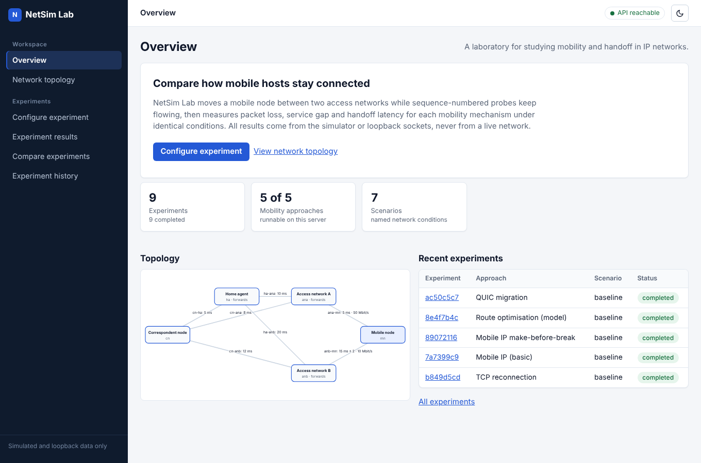
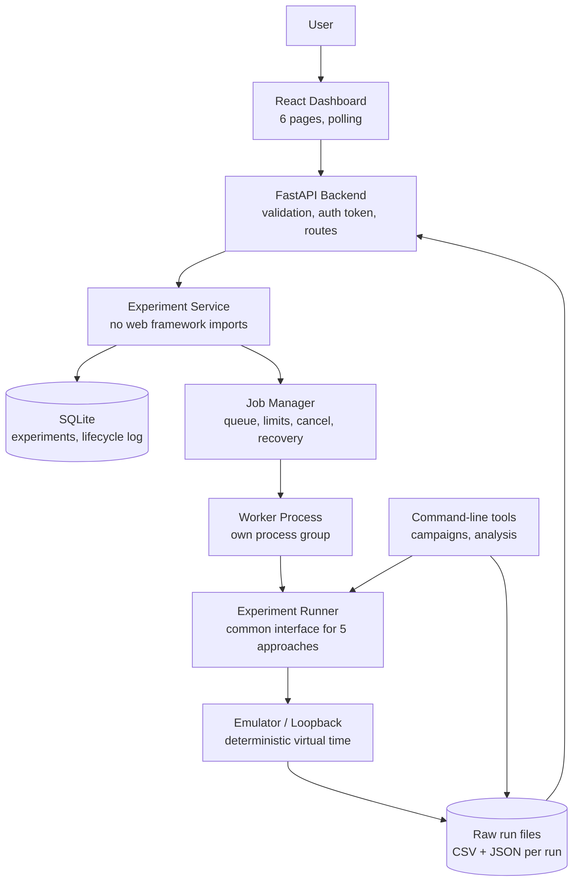
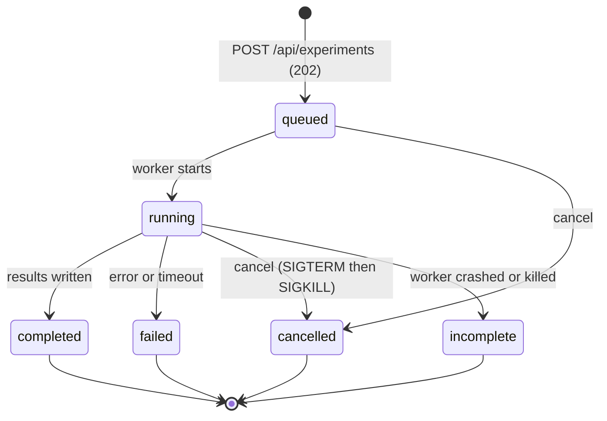
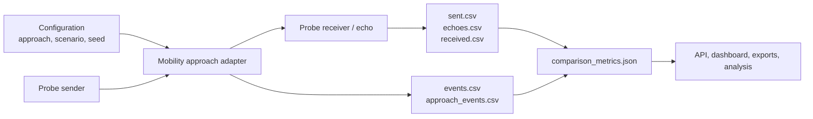
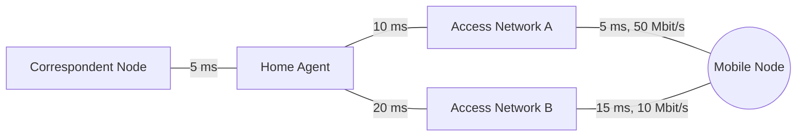
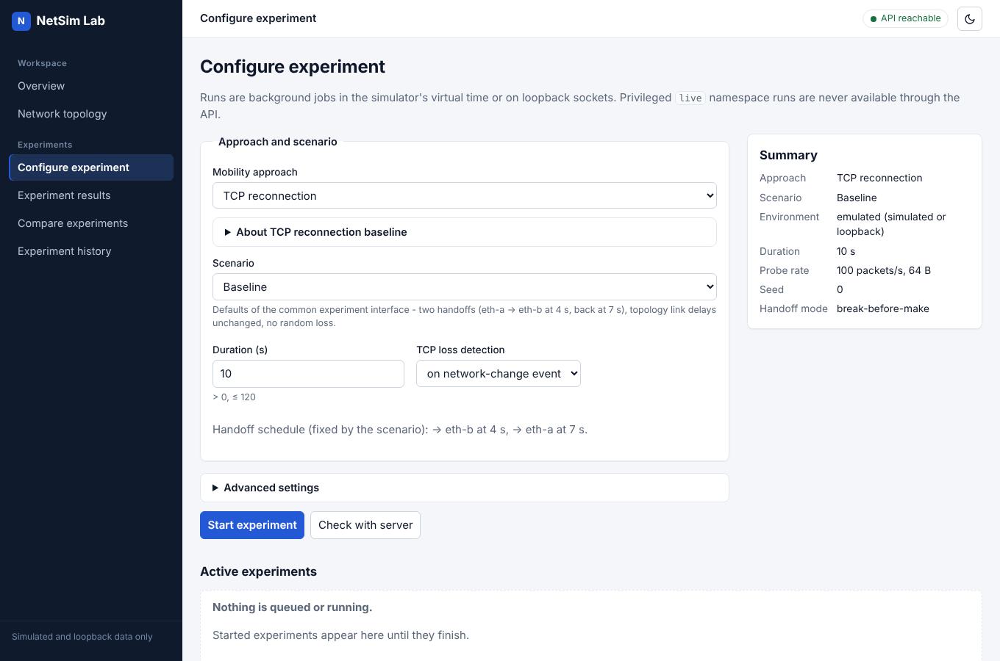
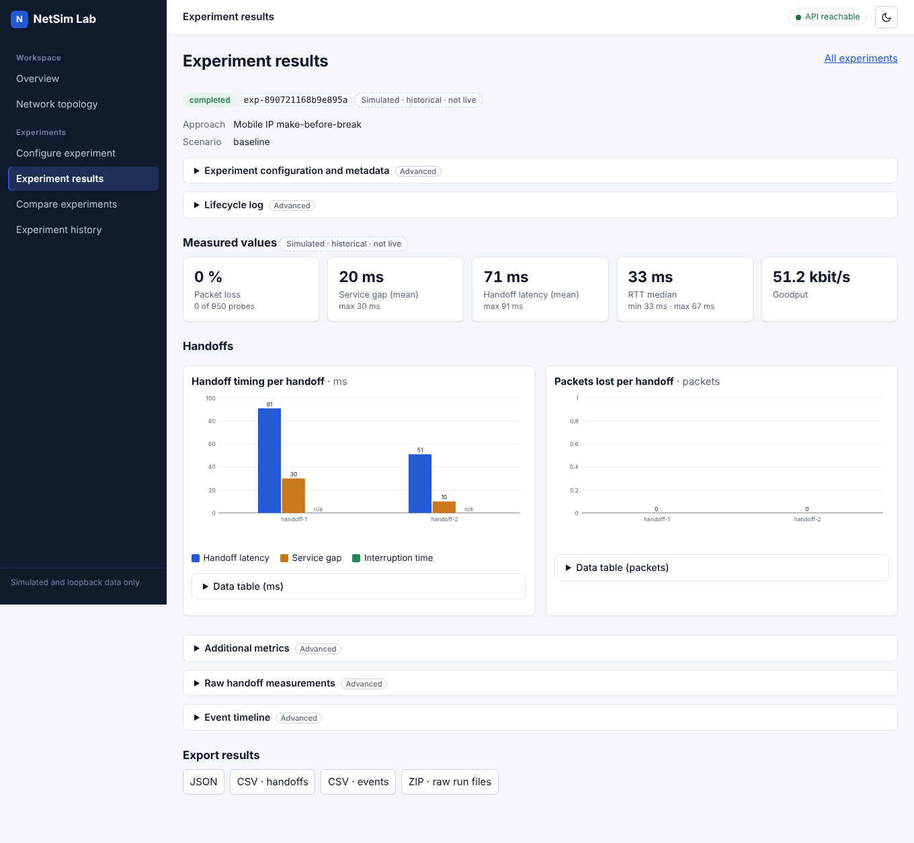
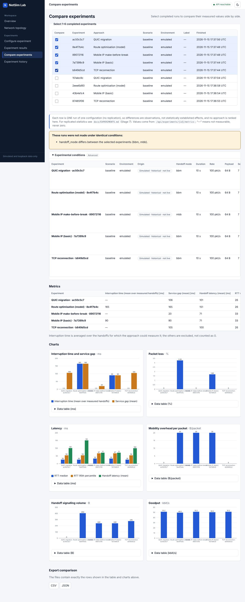
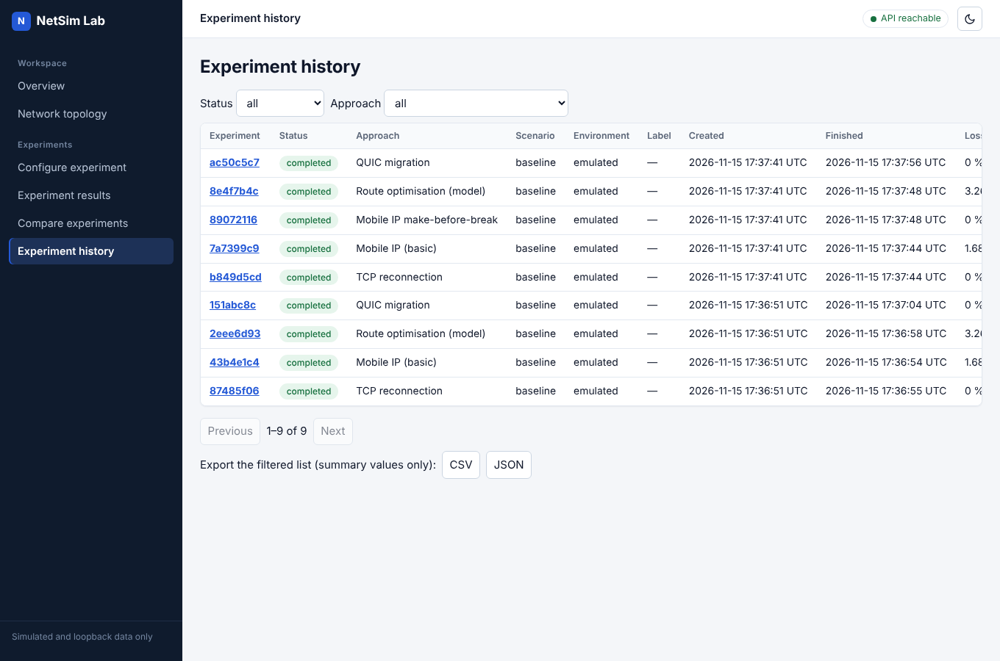

# NetSim Lab

A Computer Networks laboratory for studying **mobility and handoff**: five ways of keeping a moving host reachable (TCP reconnection, Mobile IP, make-before-break Mobile IP, route optimisation and QUIC connection migration), run through one common experiment interface, measured with the same metrics, analysed statistically, and explored in a React dashboard backed by a FastAPI service.

NetSim Lab builds a small, isolated network (a correspondent node, a home agent, a mobile node and two access networks), moves the mobile node from one access network to the other while a stream of sequence-numbered UDP probes keeps flowing, and records exactly what the application experienced: how many packets were lost, how long the service stalled, how many bytes of overhead the mobility mechanism added, and how long recovery took.

Every approach is run under the same traffic, the same topology and the same handoff schedule, so the numbers are directly comparable. Experiments can be launched from the command line, from the REST API, or from the dashboard; their raw measurements are always saved to disk, and every chart, table and export is derived from those saved files.

**Everything in this project runs on simulated or loopback networks.** The measurements describe the behaviour of the emulator under the stated parameters, not the behaviour of any real network. This is stated again wherever results are shown, including inside the dashboard.



## Contents

- [Quick start](#quick-start)
- [Installation and startup guide](#installation-and-startup-guide)
- [How it works](#how-it-works): [overview](#overview) · [approaches](#mobility-approaches) · [architecture](#system-architecture) · [topology](#lab-topology) · [methodology](#experiment-methodology) · [metrics](#metrics)
- [Using it](#using-it): [dashboard](#the-dashboard) · [command line](#command-line-reference) · [configuration](#configuration-reference) · [API](#api-reference)
- [Reproducibility](#reproducibility) · [Testing](#testing) · [Safety](#safety-and-security-model)
- [Repository structure](#repository-structure) · [Technology stack](#technology-stack)
- [Troubleshooting](#troubleshooting) · [Known limitations](#known-limitations) · [Further documentation](#further-documentation) · [License](#license)

---

## Quick start

On Linux with Python 3.10+ and Node.js 20.19+ already installed (details and other systems below):

```bash
cd netsim-lab
make setup              # once: Python environment (.venv), dependencies, .env
make frontend-install   # once: dashboard dependencies
make stack-start        # start API + dashboard in the background
```

Open **http://127.0.0.1:5173**, go to *Configure experiment*, pick *Mobile IP (basic)* and the *baseline* scenario, and click *Start experiment*. Stop everything with `make stack-stop`.

---

## Installation and startup guide

Run every command as your **normal user, never as root or with `sudo`** (only the optional network-namespace lab in step 6 uses `sudo`). The API refuses to start as root.

### Requirements

| Needed | Version | Check with |
|---|---|---|
| Linux (native, VM or WSL2) | any recent distribution | |
| Python 3 with `venv` and `pip` | 3.10 or newer (3.12 is what the project was developed and tested on) | `python3 --version` |
| Node.js and npm | **Node 20.19 or newer** (the dashboard uses Vite 7) | `node --version` |
| `git`, `make`, `curl` | any | `make --version` |
| Internet access | for the two install steps only | |

> **Node version trap:** on Debian, Ubuntu and Zorin the `nodejs` package from `apt` is often older than 20.19, and `make frontend-install` or the dashboard will then fail with confusing errors. If `node --version` prints something older, install a current Node.js with [nvm](https://github.com/nvm-sh/nvm) (`nvm install 22`) or from NodeSource, then open a new terminal and check again.

### 1. Install the system packages (once)

```bash
# Fedora
sudo dnf install -y git make curl python3 python3-pip nodejs npm

# Debian / Ubuntu / Zorin
sudo apt install -y git make curl python3 python3-venv python3-pip nodejs npm
```

Check `node --version` now (see the trap above). The optional namespace lab needs more packages: see [step 6](#6-optional-the-real-network-namespace-lab).

### 2. Get the project

```bash
cd ~
unzip ~/Downloads/netsim-lab.zip      # or: git clone <your repository URL>
cd netsim-lab
```

All commands from here on are run **from this `netsim-lab` folder**, in every terminal you open.

### 3. Install the project (once)

```bash
make check              # optional: read-only diagnostics of your machine
make setup              # creates .venv, installs the Python packages, creates .env
make frontend-install   # installs the dashboard packages into frontend/node_modules
```

You never need to "activate" the virtual environment: every `make` target uses `.venv/` directly. If you want to run Python yourself, use `.venv/bin/python` or run `source .venv/bin/activate` first.

If `make setup` fails while building a package, your Python is probably newer than the packages support. Install Python 3.12 and run `PYTHON=python3.12 make setup` (Fedora: `sudo dnf install python3.12`).

### 4. Start the application

The application has two parts: the **API** (port 8000) and the **dashboard** (port 5173). Choose one of the two ways to run them.

#### Option A: one terminal (simplest)

```bash
make stack-start
```

This starts both in the background and returns your prompt when they answer:

```
api: up   http://127.0.0.1:8000/api/health   docs: http://127.0.0.1:8000/docs   (pgid 12345)
frontend: up   http://127.0.0.1:5173/   (pgid 12399)
```

Useful companions, all in the same terminal:

| Command | What it does |
|---|---|
| `make stack-status` | shows whether each part is running and prints the API health answer |
| `make stack-logs` | follows the API log (`Ctrl+C` leaves the log; the app keeps running). Logs are in `.run/logs/` |
| `make stack-stop` | stops both cleanly |

#### Option B: two terminals (see each part's output live)

Use this when you want to watch the logs, or when Option A does not work on your machine. **Start the API first.**

| | Terminal 1: the API | Terminal 2: the dashboard |
|---|---|---|
| Open the folder | `cd ~/netsim-lab` | `cd ~/netsim-lab` |
| Start | `make run-api` | `make frontend-dev` |
| Ready when you see | `Uvicorn running on http://127.0.0.1:8000` and `Application startup complete` | `Local: http://127.0.0.1:5173/` |
| Stop | `Ctrl+C` | `Ctrl+C` |

Rules for two terminals:

* **Leave both terminals open** while you use the application; closing one stops that part. The prompt does not come back, because each command keeps running in the foreground. That is normal.
* Each terminal must be opened in the `netsim-lab` folder. No other setup is needed in the second terminal.
* `make run-api` restarts the API automatically when you edit a backend file, which interrupts any experiment that is running at that moment. If you are not changing code, that is harmless.
* Do not mix the two options: `make stack-start` and `make run-api` both want port 8000. Run `make stack-stop` before switching.

#### A third terminal for everything else

The running application does not need to be touched again. Open another terminal in the `netsim-lab` folder for anything else, for example `make api-test`, `make exp-example`, or `curl http://127.0.0.1:8000/api/health`. These can run while the application is up.

### 5. Open the dashboard and run a first experiment

| What | URL |
|---|---|
| Dashboard | http://127.0.0.1:5173 |
| API documentation (Swagger UI) | http://127.0.0.1:8000/docs |
| API health | http://127.0.0.1:8000/api/health |

1. Open **Configure experiment**.
2. Select **Mobile IP (basic)** and the **baseline** scenario.
3. Click **Start experiment**. The page follows the run (queued, running, completed) and then shows the results.

A run takes a few seconds. Results appear after the run finishes; nothing in this project streams live metrics.

To stop: `make stack-stop` (Option A) or `Ctrl+C` in each terminal (Option B). Your results are kept in `data/` and are still there next time. To start again, repeat step 4.

### 6. Optional: the real network-namespace lab

Nothing above needs this. It builds the topology in real Linux namespaces and shapes the links with `tc netem`. Read [`docs/PRIVILEGED_OPERATIONS.md`](docs/PRIVILEGED_OPERATIONS.md) first and treat it as experimental on a new machine.

```bash
# extra packages
sudo dnf install -y iproute iproute-tc iputils sudo                # Fedora
sudo apt install -y iproute2 iputils-ping sudo                     # Debian / Ubuntu / Zorin

sudo modprobe sch_netem            # Fedora: if this fails, sudo dnf install kernel-modules-extra and retry
make topo-plan                     # print the commands that would run, no privileges needed
make test-live                     # live topology tests (needs passwordless sudo for the project's commands)
```

IP-in-IP tunnelling needs kernel support (`make test-live-mip`). **WSL2:** the emulated and loopback workflows, the API and the dashboard work; the namespace lab additionally needs a kernel with namespace support, `sch_netem` and `ipip`, which the stock WSL2 kernel often lacks.

### 7. Optional: check the installation

```bash
make api-test          # about 1 minute: service layer and the HTTP API
make frontend-test     # about 1 minute: dashboard tests
```

The full backend suite is described under [Testing](#testing).

---

## How it works

### Overview

When a device moves between networks its IP address changes, and anything that was bound to the old address (a TCP connection, a registration, a route) breaks. Different mechanisms repair this at different layers and at different costs. NetSim Lab implements several of them side by side so that the trade-offs can be measured instead of just described.

The project is organised as one pipeline:

1. **Emulate** an isolated mobility topology: Linux network namespaces with `tc netem` link conditions on a real machine, or a deterministic discrete-event emulator that needs no privileges.
2. **Generate traffic** with a sequence-numbered UDP probe sender and receiver that timestamps everything with a monotonic clock.
3. **Move the mobile node** between access networks on a schedule while each mobility approach does its job.
4. **Measure** loss, interruption, application stall, RTT, jitter, goodput and mobility overhead, never inventing a value that was not measured.
5. **Store** raw CSV/JSON for every run, together with its configuration, seed and software versions.
6. **Analyse** replicated campaigns with medians, distributions, confidence intervals and paired significance tests, and export tables and charts.
7. **Serve** all of it through a FastAPI backend and **explore** it in a React dashboard.

Other capabilities worth knowing about: seven named network scenarios (baseline, doubled latency, 2 % access loss, distant home agent, slow movement detection, rapid second handoff, lossy registration); break-before-make and make-before-break handoff modes where the approach supports them; emulated, loopback and (command-line only) live kernel environments; unsupported combinations are reported explicitly instead of being silently skipped; an incomplete run is recorded as incomplete.

### Mobility approaches

| Approach | Id | What it is | Overhead | Notes |
|---|---|---|---|---|
| TCP reconnection | `tcp-reconnect` | No mobility protocol. The address change kills the TCP connection; the application detects it (OS notification or stall timeout), reconnects from the new address and resumes its session. Two detection variants: `notify` and `stall-timeout` | none specific | In the emulator TCP is a simplified model (TcpLite); the same application logic is also validated over real kernel TCP on loopback |
| Basic Mobile IP | `mip-basic` | Educational Mobile IPv4-style demonstration: signed, replay-protected registration with the Home Agent, IP-in-IP tunnelling to the care-of address, direct replies (triangle routing) | 20 B per packet | Not RFC 5944 compliant: HMAC-SHA256 instead of keyed MD5, no foreign agent, no ARP, no reverse tunnelling |
| Mobile IP, make-before-break | `mip-mbb` | Basic Mobile IP with an overlap period: the new link is up before the old one is released | 20 B per packet | A testbed extension, not a separate protocol |
| Route optimisation (model) | `ro-model` | Basic Mobile IP plus a Return Routability exchange and an authenticated Binding Update, after which the correspondent sends directly to the care-of address | 20 B per packet on the direct path | A simplified model inspired by Mobile IPv6 route optimisation. It is not Mobile IPv6 |
| QUIC connection migration | `quic-migration` | A real QUIC engine (`aioquic`) migrating one connection to a new path with a fresh connection ID and path validation | none specific | `aioquic` is in `requirements.txt` and installed by `make setup`. If the library is missing the option stays visible but disabled with the install hint (`pip install aioquic`). Works only for applications that use QUIC; it does not make arbitrary TCP applications mobile |

The project deliberately separates what is implemented protocol behaviour from what is a simplified emulation. See [`docs/MOBILE_IP.md`](docs/MOBILE_IP.md) and [`docs/MOBILITY_COMPARISON.md`](docs/MOBILITY_COMPARISON.md) for exactly what each approach does and does not claim.

### System architecture



The dashboard, API, exports and saved analysis all read the **same per-run files**. Nothing is cached or recomputed in the browser beyond display formatting, so a number on screen can always be traced to a file on disk.

#### Experiment lifecycle



Every transition is appended to a lifecycle log. When the server restarts, runs that were `running` are marked `incomplete`, orphaned workers are killed (a recycled process ID is never mistaken for a worker), and queued runs stay queued.

#### Data flow of one run



### Lab topology



| Link | Delay | Other conditions |
|---|---|---|
| Correspondent Node ↔ Home Agent | 5 ms | |
| Home Agent ↔ Access Network A | 10 ms | |
| Home Agent ↔ Access Network B | 20 ms | |
| Access Network A ↔ Mobile Node | 5 ms | 50 Mbit/s |
| Access Network B ↔ Mobile Node | 15 ms | 10 Mbit/s, 2 ms jitter configured for live netem (the emulator does not model jitter) |

On a real machine each node is a Linux **network namespace** connected by **veth pairs**, with `tc netem` shaping the links; routing and forwarding are configured inside the namespaces, never on the host. The default baseline scenario moves the mobile node from Access Network A to B at 4 s and back at 7 s.

### Experiment methodology

* **One interface.** Every approach is run through the same experiment specification: approach, scenario, environment, handoff mode, duration, probe rate, payload size, seed, and network conditions (latency scale, access loss, home-agent distance, registration loss, home-agent processing time, movement-detection delay).
* **Same conditions.** The comparison page warns whenever the selected runs were not made under identical conditions.
* **Seeds.** Every handoff schedule and random loss stream derives from a base seed, so the same configuration reproduces byte for byte.
* **Replication.** Campaigns repeat each configuration (12 replicates in the example campaign, 20 in the standard one) and vary one factor at a time around the baseline. Repeated samples from one run are never treated as independent.
* **Statistics.** Medians and quartiles with exact distribution-free 95 % confidence intervals, paired comparisons with a Wilcoxon signed-rank test, Holm correction and seeded bootstrap intervals for the median difference.
* **Failures are data.** Failed, incomplete and not-executed cells are kept, counted and reported; they are never silently dropped.
* **Provenance.** Every reported value is tagged as *measured*, *simulator-generated* or *derived*.
* **No fabrication.** A metric that cannot be measured for an approach is shown as unavailable (`—`), never as zero. Loss is derived from sequence numbers, never estimated.
* **No unsupported claims.** A difference is called *distinguishable* only when the Holm-adjusted p-value is below the threshold **and** the bootstrap interval of the median difference excludes zero.

Details: [`docs/EXPERIMENTS.md`](docs/EXPERIMENTS.md), [`docs/TRAFFIC_MEASUREMENT.md`](docs/TRAFFIC_MEASUREMENT.md).

### Metrics

| Metric | Meaning |
|---|---|
| Packet loss | Probes sent minus probes received, from sequence numbers (exact) |
| Interruption time | Time during which the mobile node received nothing across a handoff |
| Service gap | Largest gap between consecutive echo arrivals around a handoff |
| Handoff latency | Time from link change to the approach's own recovery point (first accepted registration reply, accepted binding update, first new data, …) |
| Application stall | How long the application-level stream stopped making progress |
| RTT (median, p95) | Round-trip time of echoed probes |
| Goodput | Delivered throughput of echoed data |
| Mobility overhead | Extra bytes per packet added by the mobility mechanism (for example 20 B of IP-in-IP) |
| Signalling volume | Messages and bytes exchanged per handoff |
| Path stretch | Ratio of the path actually used to the direct path |

Baseline medians from a reference run of the example campaign (12 replicates per approach, simulator-generated; `make exp-example` regenerates them together with confidence intervals and caveats):

| Approach | Application stall, median (ms) | Probe loss, median (%) |
|---|---|---|
| Mobile IP, make-before-break | 20.0 | 0.00 |
| Basic Mobile IP | 80.0 | 1.22 |
| TCP reconnection (OS notification) | 104.75 | 0.00 (reliable transport, loss appears as delay) |
| Route optimisation (model) | 160.0 | 2.61 |
| TCP reconnection (stall timeout) | 636.25 | 0.00 |

These describe the emulator under its stated parameters. Some cells have zero-width intervals because the simulator is deterministic there.

---

## Using it

### The dashboard

| Group | Page | Route | What it shows |
|---|---|---|---|
| Workspace | Overview | `#/overview` | What the lab is, a configure shortcut, three counts read from the API, the topology and recent runs |
| Workspace | Network topology | `#/topology` | One diagram of the five nodes and their link conditions; node, link and route tables below it |
| Experiments | Configure experiment | `#/configure` | Approach, scenario and duration up front; probe rate, payload, seed, environment, condition overrides and label under **Advanced settings**; live summary; active runs with a Stop button |
| Experiments | Experiment results | `#/live/<id>` | Packet loss, service gap, handoff latency, RTT and goodput, two handoff charts and exports; additional metrics, raw handoff table, event timeline, configuration and lifecycle log under **Advanced** sections |
| Experiments | Compare experiments | `#/compare` | 1-6 completed runs side by side, a warning when conditions differ, charts and exports; no winner is declared |
| Experiments | Experiment history | `#/history` | All runs with status and approach filters, per-run details and CSV/JSON export |

| Configure | Results |
|---|---|
|  |  |
| **Compare** | **History** |
|  |  |

The header has a light/dark theme toggle; the choice is stored in the browser. Every value is labelled with its origin (simulated, historical, not live), every chart has an accessible table behind it, and every result view has CSV/JSON export. The backend executes runs in the emulator's virtual time and writes the metrics when a run finishes, so there is no live metric stream: the dashboard **polls** the lifecycle and shows measurements after completion, and says so on screen. The dashboard talks to the API through the relative path `/api`; the Vite dev server proxies it to `127.0.0.1:8000`.

### Command-line reference

All tools run from the project root as `PYTHONPATH=backend .venv/bin/python -m app.<tool> …`. Run `make help` for the list of every make target.

| Tool | Purpose | Example |
|---|---|---|
| `app.netem` | Validate, plan, create, inspect and destroy the namespace topology | `scripts/topology.sh plan` |
| `app.traffic` | Probe sender/receiver, run analysis | `python -m app.traffic analyze <run-dir> --no-write` |
| `app.mobileip` | Emulated Mobile IP handoff demonstration | `make mip-sim` |
| `app.compare` | Run one approach, a matrix, or a replicated campaign; analyse; plot; reproduce | `python -m app.compare list` |

Run a single experiment from the command line (no server needed):

```bash
PYTHONPATH=backend .venv/bin/python -m app.compare run \
  --approach mip-basic --seed 1 --duration 12 --out-dir data/demo
```

Useful `make` targets:

| Target | What it does |
|---|---|
| `make compare` | Run the standard comparison matrix and write the report to `data/results/comparison` |
| `make exp-list` / `exp-plan` | Show approaches and the design of the example campaign |
| `make exp-example` | Run or resume the 372-run example campaign (about 15–20 minutes), analyse and plot it into `data/experiments/example` |
| `make exp-standard` | Run the full 20-replicate campaign (about 1,700 runs, about 30 minutes, about 330 MB) |
| `make exp-analyze DIR=…` | Recompute statistics, exports and the report from saved results |
| `make exp-plots DIR=…` | Regenerate charts from saved analysis |
| `make exp-reproduce DIR=…` | Re-run a sample of saved runs and verify they are byte-identical |
| `make e2e-browser` | Drive the dashboard in real headless Chrome (needs Playwright, Chrome and esbuild) |
| `make lint` | `ruff check` the backend |

### Configuration reference

Copy `.env.example` to `.env` (done by `make setup`). Every variable is optional; process environment wins over the file.

| Variable | Default | Meaning |
|---|---|---|
| `NETSIM_API_HOST` / `NETSIM_API_PORT` | `127.0.0.1` / `8000` | Where the API listens (used by `make stack-start`, `make run-api` and the dashboard's dev proxy) |
| `NETSIM_FRONTEND_PORT` | `5173` | Dashboard port (`make stack-start`, `make frontend-dev`) |
| `NETSIM_CORS_ORIGINS` | `["http://localhost:5173"]` | Allowed browser origins |
| `NETSIM_NETNS_PREFIX` | `nsl-` | Prefix of every namespace the project creates; anything without it is never touched |
| `NETSIM_DRY_RUN` | `true` | The topology CLI only prints commands unless `--execute` is given |
| `NETSIM_API_DATA_DIR` | `data/api` | SQLite database and one directory per experiment |
| `NETSIM_API_MAX_CONCURRENT_JOBS` | `2` | Worker processes at once |
| `NETSIM_API_MAX_QUEUE` | `20` | Waiting experiments before the API answers `429` |
| `NETSIM_API_MAX_RUNTIME_S` | `300` | Wall-clock limit per experiment |
| `NETSIM_API_CANCEL_GRACE_S` | `3` | Delay between SIGTERM and SIGKILL when cancelling |
| `NETSIM_API_RETENTION_DAYS` | `30` | Delete finished experiments after N days (`0` = keep) |
| `NETSIM_API_MAX_DURATION_S` / `_MAX_RATE_PPS` / `_MAX_PROBES` | `120` / `1000` / `120000` | Per-request limits |
| `NETSIM_API_ENVIRONMENTS` | `emulated,loopback` | Environments the API may use (`live` can never be enabled) |
| `NETSIM_API_TOKEN` | *(unset)* | If set, every `/api` route except `/api/health` requires `Authorization: Bearer <token>` |
| `NETSIM_API_ALLOW_ROOT` | `0` | Set to `1` only inside a disposable container |
| `NETSIM_STOP_GRACE_S` | `8` | `make stack-stop` waits this long before force-killing |

With no token set, **anyone on the local machine can use the API**. Set `NETSIM_API_TOKEN` before exposing it beyond localhost. The dashboard has no field for entering a token.

### API reference

Base path `/api`. Interactive documentation is served at `/docs`; the full request schema, error codes and examples are in [`docs/API.md`](docs/API.md).

| Endpoint | Purpose |
|---|---|
| `GET /api/health` | Liveness |
| `GET /api/approaches` | The five approaches, what they are and are not, and where they can run on this server |
| `GET /api/scenarios` | Named scenarios with every resolved parameter |
| `GET /api/topology` | Nodes, links, routes and configured link conditions |
| `GET /api/capabilities` | Limits and accepted fields |
| `GET /api/status` | Job-manager state and counts per status |
| `POST /api/experiments/validate` | Check a request without running it |
| `POST /api/experiments` | Validate and queue (`202`); idempotent replay returns `200` |
| `GET /api/experiments` | History with filters (status, approach, scenario, environment, dates, label), sort and paging |
| `GET /api/experiments/{id}` | Status, configuration, progress, error, summary |
| `GET /api/experiments/{id}/transitions` | Append-only lifecycle log for incremental polling |
| `POST /api/experiments/{id}/cancel` | Cancel a queued or running experiment |
| `DELETE /api/experiments/{id}` | Delete a finished experiment and its files |
| `GET /api/experiments/{id}/metrics` | The run's metrics with provenance |
| `GET /api/experiments/{id}/handoffs` | Per-handoff metrics and summary |
| `GET /api/experiments/{id}/events` | Raw approach event log, paginated |
| `GET /api/experiments/{id}/export?format=json\|csv\|zip` | Export one experiment |
| `GET /api/history/export?format=csv\|json` | One summary row per experiment |

```bash
curl -s -X POST http://127.0.0.1:8000/api/experiments \
  -H 'content-type: application/json' \
  -d '{"approach":"mip-basic","scenario":"baseline","seed":1,"duration_s":12}'
```

Errors carry a machine-readable `code` and a human message; common codes include `queue_full` (429), `not_cancellable` (409), `experiment_active` (409) and `results_not_available` (409). The complete list is in `docs/API.md`.

---

## Reproducibility

* Raw CSV/JSON, configuration, seeds and software versions are kept for every run.
* `python -m app.compare reproduce <campaign-dir> --sample N` re-executes saved runs and compares their files **byte for byte** (`--sample 0` re-runs all of them).
* `python -m app.compare analyze <campaign-dir>` regenerates the statistics, tables, charts and report from the saved raw runs alone.
* Typical workflow: `make exp-example`, then `make exp-reproduce DIR=data/experiments/example`.
* The example campaign uses the fixed base seed `20261028`; change it in `config/experiments/example.yaml` to draw a different, equally valid sample.
* `backend/tests/fixtures/baseline_runs/` holds three recorded reference runs; a regression test checks that the code still reproduces them byte for byte under default conditions.

## Testing

| Suite | Command | Notes |
|---|---|---|
| Backend, quick | `make test` | `pytest` over `backend/tests` (45 modules) |
| Backend, report | `make test-report` | One process per test module (about 12 minutes); writes `data/reports/TEST_REPORT.md` |
| API | `make api-test` | Service layer, store, jobs (real worker processes), validation, exports and the HTTP layer (about 1 minute) |
| Frontend | `make frontend-test` | Unit, view and interaction tests (vitest) |
| Browser end-to-end | `make e2e-browser` | Real headless Chrome against the real service layer; starts, cancels and exports experiments and compares on-screen values with the API |
| Live lab | `make test-live`, `make test-live-mip` | Need `sudo`, `ip`, `tc` and kernel tunnel support; skipped by default |

A few tests are skipped on purpose when the machine lacks something (`aioquic`, `sudo`, kernel tunnel support, or the privileged-tests switch). Cleanup behaviour is covered for success, failure, timeout, crash, external kill, cancellation (queued and running), server restart, recycled process IDs and namespace rollback.

## Safety and security model

| Area | Design |
|---|---|
| Privilege | The Python process always runs as a normal user and refuses to start as root. Only individual `ip` commands are elevated, one at a time, with `sudo -n` |
| Command allow-list | Every argument vector is checked against an allow-list before execution; only `ip` is invoked (`tc`, `sysctl`, `ping` only through `ip netns exec` on project namespaces) |
| Namespaces | Names must be `nsl-` plus a node key. `default`, `docker`, uppercase, path-like and shell-metacharacter names are refused. Cleanup deletes only names that are valid and listed by the project's own configuration |
| Host protection | No firewall tools anywhere in the command grammar; no host default-route or host-interface changes; sysctls scoped to the namespace |
| API | No shell, no arbitrary commands. The worker is launched with a fixed argument vector, `shell=False`, its own process group and a minimal environment (the API token is not inherited). The `live` environment is rejected with `environment_not_exposed` |
| Validation | Whitelisted approaches, scenarios and environments; numeric limits; experiment IDs matched against a strict pattern before any path is built; SQL is parameterised and sort columns are allow-listed |
| Concurrency | Concurrent-job and queue limits, a duplicate-run guard (unique index), one job manager per data directory, writes inside `BEGIN IMMEDIATE` |
| Secrets | Optional bearer token compared in constant time; `.env` is git-ignored; no credentials in the repository |

The one cryptographic constant in the code (`RO_SECRET` in the route-optimisation simulation) is labelled demo-only.

---

## Repository structure

```text
netsim-lab/
├── backend/
│   ├── app/
│   │   ├── main.py                  FastAPI application factory
│   │   ├── config.py                environment-driven settings
│   │   ├── api/                     routes, error handlers, request/response schemas, auth dependency
│   │   ├── services/                experiment service, SQLite store, job manager, worker launcher,
│   │   │                            validation, results, exports, catalog
│   │   ├── netem/                   namespace topology: plans, safety allow-list, runner, CLI
│   │   ├── traffic/                 UDP probe sender/receiver, metrics, recorder, clock, loopback proxy
│   │   ├── mobileip/                home agent, mobile node, registration, IP-in-IP, route optimisation,
│   │   │                            discrete-event network simulator
│   │   └── compare/                 common experiment interface, approach adapters, TcpLite,
│   │                                QUIC adapter, campaigns, statistics, plots, reproducibility check
│   └── tests/                       45 test modules; fixtures/baseline_runs = recorded reference runs
│
├── frontend/
│   ├── src/
│   │   ├── pages/                   Overview, Topology, Configure, Live (results), Compare, History
│   │   ├── components/              badges, state views, accessible SVG charts
│   │   ├── api/                     client and endpoint wrappers
│   │   ├── lib/                     metrics, formatting, validation, polling, routing, CSV/download helpers
│   │   └── test/fixtures/api/       real API responses used by the tests
│   ├── scripts/                     live-API integration test runner
│   └── package.json, vite.config.js, index.html
│
├── config/
│   ├── topology.yaml                the five-node lab (nodes, links, routes, netem values)
│   ├── topology_ro.yaml             topology variant for route optimisation
│   ├── scenarios/                   handoff schedules
│   ├── api/scenarios.yaml           the seven named scenarios offered by the API
│   └── experiments/                 campaign definitions (example: 372 runs, standard: about 1,700 runs)
│
├── schemas/                         JSON schemas for metrics, run metadata, CSV columns and the OpenAPI document
├── scripts/                         setup, environment check, topology wrapper, stack start/stop,
│                                    test runner, API smoke test, browser end-to-end check
├── docs/                            in-depth documentation and the README screenshots
├── Makefile                         every common task as a target (`make help`)
├── requirements.txt / requirements-dev.txt
├── pytest.ini
└── .env.example
```

Created at run time and git-ignored: `.venv/` (Python environment), `frontend/node_modules/`, `.env` (your settings), `.run/` (pid files and logs of `make stack-start`) and `data/` (API database, experiment run files, campaign output and test reports; created on first use).

## Technology stack

| Layer | Technology |
|---|---|
| Backend framework | FastAPI, Uvicorn, Pydantic v2, pydantic-settings |
| Language | Python 3.12 (the version the project was developed and tested on; 3.10+ is required) |
| Experiment store | SQLite (WAL mode) with partial unique indexes for duplicate and idempotency protection |
| Job execution | Worker **processes**, each in its own process group, with timeout, cancel and crash recovery |
| Network emulation | Linux network namespaces, veth pairs, iproute2 (`ip`), `tc netem` |
| Traffic | UDP probes over sockets, monotonic clocks |
| Mobility | Own Mobile IP implementation (HMAC-SHA256, IP-in-IP), simplified route-optimisation model, TcpLite, `aioquic` |
| Data and statistics | NumPy, SciPy, pandas, bootstrap confidence intervals |
| Charts | Matplotlib (analysis), hand-written accessible SVG (dashboard) |
| Frontend | React 18, Vite 7, plain CSS |
| Frontend tests | Vitest, React Testing Library, jsdom |
| Tooling | Make, ruff, pytest/unittest |

---

## Troubleshooting

| Symptom | Likely cause and fix |
|---|---|
| `Permission denied` when a script runs | The zip did not keep the executable bit. Run `chmod +x scripts/*.sh frontend/scripts/*.sh` once (the Makefile calls the scripts through `bash`, so `make` targets work either way) |
| `make: ... No such file` for `.venv/bin/python`, or `fastapi/uvicorn … are not importable` | The Python install did not run. Run `make setup` from the `netsim-lab` folder |
| `frontend dependencies missing` | Run `make frontend-install` |
| `make frontend-install` or `make frontend-dev` fails with syntax or engine errors | Node.js is too old. Run `node --version`; it must be 20.19 or newer (see the [Node version trap](#requirements)) |
| `make setup` fails while building a package | Your Python is newer than the packages support. Install `python3.12` and run `PYTHON=python3.12 make setup` |
| `refusing to start the job manager as root` | You ran the API as root or with `sudo`. Use your normal user (`NETSIM_API_ALLOW_ROOT=1` only inside a disposable container) |
| `port 8000 / 5173 is already in use` | Another process (or a previous run) holds the port. `make stack-stop`, or stop the other process, or set `NETSIM_API_PORT` / `NETSIM_FRONTEND_PORT` for **both** terminals |
| Two-terminal mode: prompt never comes back | Expected. The command runs in the foreground until you press `Ctrl+C`. Use another terminal for other commands |
| Dashboard header says *API: unreachable* | The API is not running or crashed. Option A: `make stack-status`, then read `.run/logs/api.log`. Option B: look at terminal 1 |
| QUIC migration is greyed out on the Configure page | `aioquic` is not importable in `.venv`. Run `.venv/bin/pip install -r requirements.txt`, then restart the API |
| `429 queue_full` | More than 20 experiments are waiting; wait or cancel some |
| `409 results_not_available` | The run has not finished (or failed); open its status page |
| `sudo modprobe sch_netem` fails | Fedora: `sudo dnf install kernel-modules-extra` and retry |
| Live kernel tunnel tests skipped | The kernel refuses `ipip` links; the emulated Mobile IP path is unaffected |
| `ModuleNotFoundError: app` when running a tool | Run from the project root with `PYTHONPATH=backend` |
| `make exp-reproduce` / `exp-analyze` fails with missing runs | The raw runs do not exist yet. Run `make exp-example` first and use `DIR=data/experiments/example` |

## Known limitations

* All results are simulator-generated or loopback. The emulator is deterministic: fixed link delays, no random loss or jitter in the default scenario, abrupt handoffs.
* Mobile IP here is educational, not an RFC 5944 implementation. Route optimisation is a simplified model of a Mobile IPv6 feature. TcpLite is a model of TCP. QUIC migration uses the real `aioquic` engine but only works for QUIC applications.
* The dashboard has no live metric stream; it polls and shows measurements after a run completes. The comparison metrics do not include jitter. There is no UI for entering an API token.
* Browser coverage so far is Chrome at one viewport width; dark mode, focus order and other browsers are unchecked.
* The privileged lab (`tc netem`, kernel tunnels) depends on your kernel and has been validated mainly through command plans and the emulator.
* The API has no user accounts. Without a token it trusts anyone on the machine.

## Further documentation

| Document | Contents |
|---|---|
| [`docs/FEATURES.md`](docs/FEATURES.md) | Every feature and combination, in depth, and how it works |
| [`docs/ARCHITECTURE.md`](docs/ARCHITECTURE.md) | Modules, data flow, design decisions |
| [`docs/API.md`](docs/API.md) | Every endpoint, request schema, error codes, job semantics |
| [`docs/FRONTEND.md`](docs/FRONTEND.md) | Dashboard design, pages, testing strategy |
| [`docs/EXPERIMENTS.md`](docs/EXPERIMENTS.md) | Campaign configuration, statistics, charts, reproducibility |
| [`docs/MOBILITY_COMPARISON.md`](docs/MOBILITY_COMPARISON.md) | The common interface and the five approaches |
| [`docs/MOBILE_IP.md`](docs/MOBILE_IP.md) | The Mobile IP implementation and its limits |
| [`docs/TRAFFIC_MEASUREMENT.md`](docs/TRAFFIC_MEASUREMENT.md) | Probe protocol, clocks, metric definitions |
| [`docs/PRIVILEGED_OPERATIONS.md`](docs/PRIVILEGED_OPERATIONS.md) | Exactly which commands run with elevated rights, and the guard rails |
| [`docs/DEMO_GUIDE.md`](docs/DEMO_GUIDE.md) | Step-by-step demo script with expected numbers |

## License

Licensed under the Apache License 2.0. See [LICENSE](LICENSE) and [NOTICE](NOTICE).
