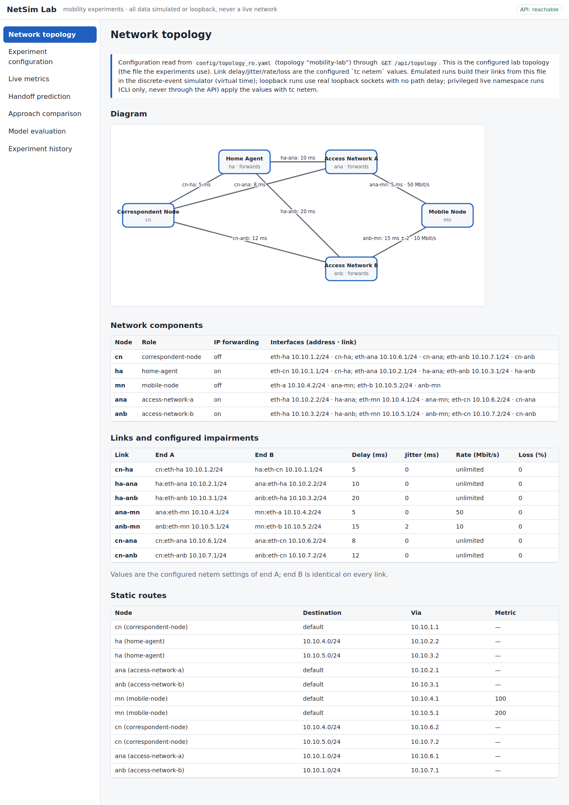
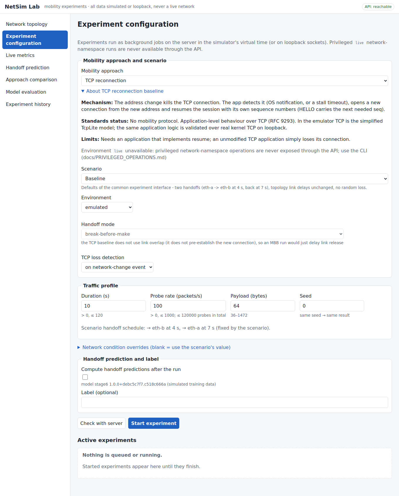
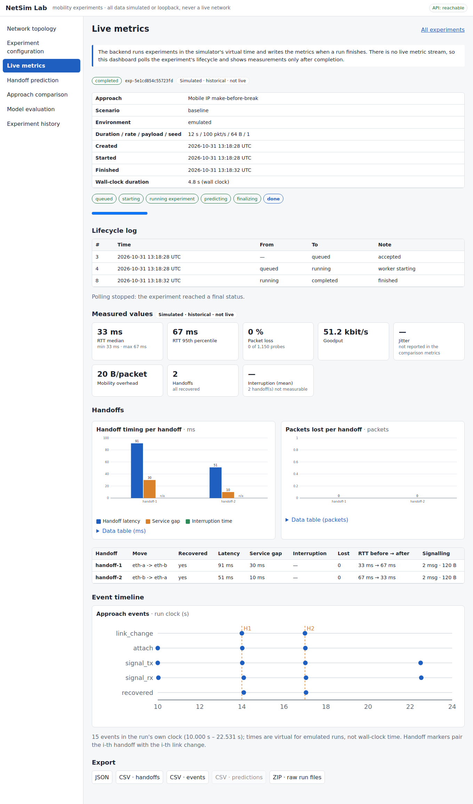
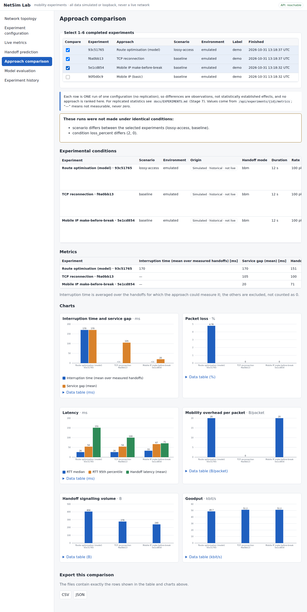
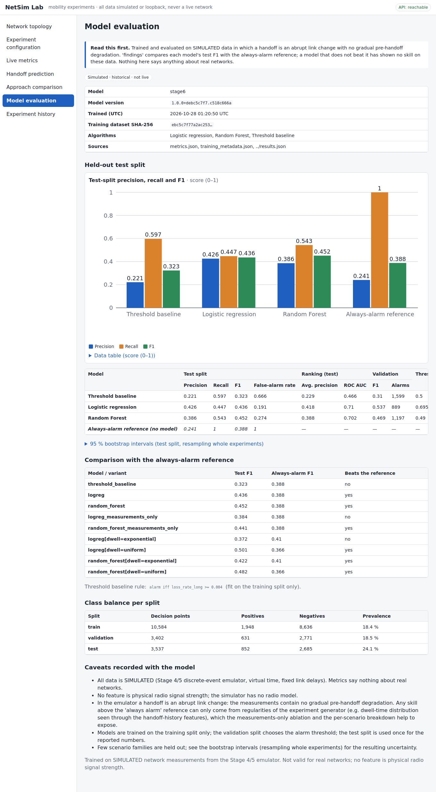
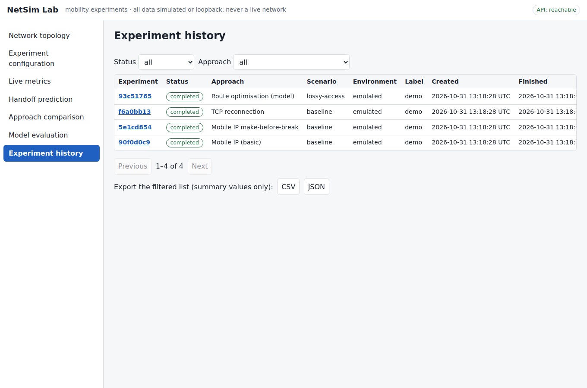
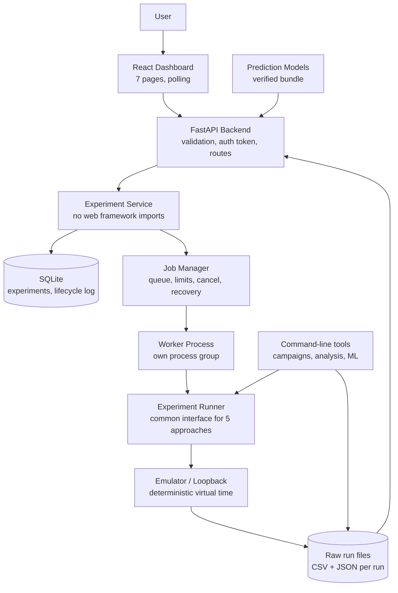
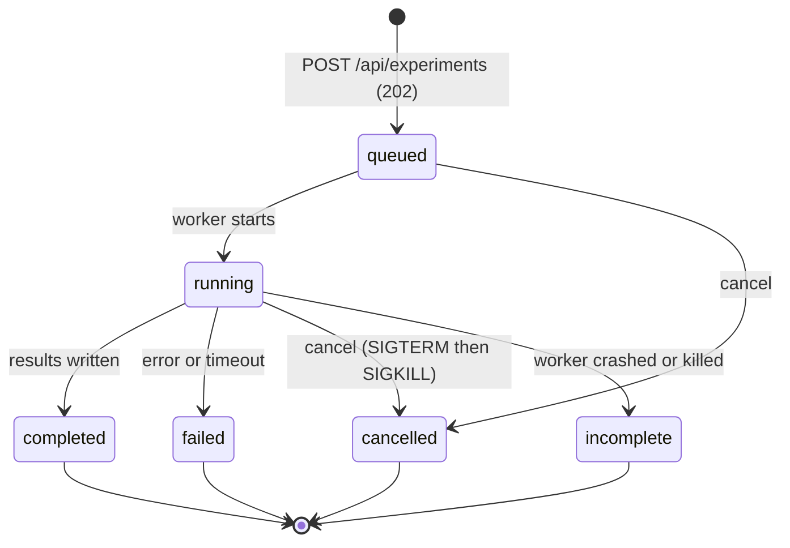
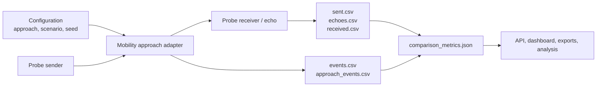
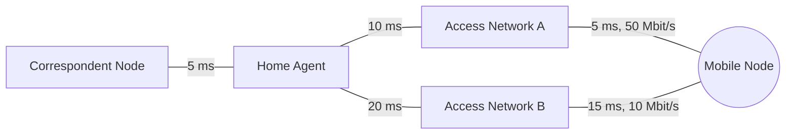

# NetSim Lab


> A Computer Networks laboratory for studying **mobility and handoff**: five ways of keeping a moving host reachable (TCP reconnection, Mobile IP, make-before-break Mobile IP, route optimisation and QUIC connection migration), run through one common experiment interface, measured with the same metrics, analysed statistically, and explored in a React dashboard backed by a FastAPI service.

NetSim Lab builds a small, isolated network (a correspondent node, a home agent, a mobile node and two access networks), moves the mobile node from one access network to the other while a stream of sequence-numbered UDP probes keeps flowing, and records exactly what the application experienced: how many packets were lost, how long the service stalled, how many bytes of overhead the mobility mechanism added, and how long recovery took.

Every approach is run under the same traffic, the same topology and the same handoff schedule, so the numbers are directly comparable. Experiments can be launched from the command line, from the REST API, or from the dashboard; their raw measurements are always saved to disk, and every chart, table and export is derived from those saved files.

**Everything in this project runs on simulated or loopback networks.** The measurements describe the behaviour of the emulator under the stated parameters, not the behaviour of any real network. This is stated again wherever results are shown, including inside the dashboard.

## Table of Contents

- [Screenshots](#screenshots)
- [Overview](#overview)
- [Key Features](#key-features)
- [Mobility Approaches](#mobility-approaches)
- [System Architecture](#system-architecture)
- [Lab Topology](#lab-topology)
- [Repository Structure](#repository-structure)
- [Technology Stack](#technology-stack)
- [Experiment Methodology](#experiment-methodology)
- [Metrics](#metrics)
- [Handoff Prediction](#handoff-prediction)
- [Running the Project from Scratch (Fedora 44 KDE)](#running-the-project-from-scratch-fedora-44-kde)
- [Other Linux Distributions](#other-linux-distributions)
- [Running the Application](#running-the-application)
- [The Dashboard](#the-dashboard)
- [Command-Line Reference](#command-line-reference)
- [Configuration Reference](#configuration-reference)
- [API Reference](#api-reference)
- [Reproducibility](#reproducibility)
- [Testing](#testing)
- [Safety and Security Model](#safety-and-security-model)
- [Troubleshooting](#troubleshooting)
- [Known Limitations](#known-limitations)
- [Further Documentation](#further-documentation)
- [License](#license)

## Screenshots

**Network topology** — the five-node lab, its links and the configured link conditions, read from the API.



**Experiment configuration** — choose an approach and scenario; the form validates input before anything is queued.



**Live metrics** — lifecycle of a run, headline measurements, per-handoff timing, packets lost per handoff, and the raw event timeline.



**Approach comparison** — up to six completed experiments side by side, with a warning whenever their conditions differ.



**Model evaluation** — held-out results of the handoff-prediction models, with their caveats.



**Experiment history** — every run, filterable, with JSON/CSV/ZIP export.



## Overview

When a device moves between networks its IP address changes, and anything that was bound to the old address (a TCP connection, a registration, a route) breaks. Different mechanisms repair this at different layers and at different costs. NetSim Lab implements several of them side by side so that the trade-offs can be measured instead of just described.

The project is organised as one pipeline:

1. **Emulate** an isolated mobility topology (Linux network namespaces with `tc netem` link conditions on a real machine, or a deterministic discrete-event emulator that needs no privileges).
2. **Generate traffic** with a sequence-numbered UDP probe sender and receiver that timestamps everything with a monotonic clock.
3. **Move the mobile node** between access networks on a schedule while each mobility approach does its job.
4. **Measure** loss, interruption, application stall, RTT, jitter, goodput and mobility overhead, never inventing a value that was not measured.
5. **Store** raw CSV/JSON for every run, together with its configuration, seed and software versions.
6. **Analyse** replicated campaigns with medians, distributions, confidence intervals and paired significance tests, and export tables and charts.
7. **Predict** upcoming handoff-related degradation with a threshold rule, logistic regression and a random forest, evaluated on held-out scenario families.
8. **Serve** all of it through a FastAPI backend and **explore** it in a React dashboard.

## Key Features

### Mobility Experiments
* Five mobility approaches behind one experiment interface, selected by name
* Seven named network scenarios (baseline, doubled latency, 2 % access loss, distant home agent, slow movement detection, rapid second handoff, lossy registration)
* Break-before-make and make-before-break handoff modes where the approach supports them
* Emulated, loopback and (command-line only) live kernel environments
* Unsupported combinations are reported explicitly instead of being silently skipped

### Measurement
* Sequence-numbered UDP probes with send and receive timestamps
* Loss derived from sequence numbers, never estimated
* Monotonic clocks, with the clock limitations documented
* Safe handling of interrupted runs: an incomplete run is recorded as incomplete

### Analysis
* Replicated campaigns with fixed seeds (12 replicates per configuration in the example campaign)
* Medians and quartiles with exact distribution-free 95 % confidence intervals, paired comparisons with a Wilcoxon signed-rank test, Holm correction and seeded bootstrap intervals for the median difference
* 24 generated charts, CSV and JSON exports, and a Markdown report
* Repeated samples from one run are never treated as independent observations

### Prediction
* Explicit labels and prediction window, features computed only from past observations
* Threshold baseline, logistic regression and random forest
* Split by scenario family rather than by random rows, so correlated observations never leak between training and test sets
* Model bundles with a verified manifest

### Backend API
* FastAPI service with validated requests, a job queue, worker processes and cancellation
* SQLite experiment store with an append-only lifecycle log
* Idempotent submission, duplicate-run protection, concurrency and queue limits
* Metrics, handoffs, raw events, predictions, model evaluation and exports (JSON, CSV, ZIP)

### Dashboard
* Seven pages on the real API: topology, configuration, live metrics, handoff prediction, approach comparison, model evaluation and experiment history
* No hard-coded or fabricated numbers; every value shown comes from an API response
* Every value is labelled with its origin (simulated, historical, not live)
* Accessible tables behind every chart, CSV/JSON export on every result view

### Safety
* The application never runs as root; only individual, allow-listed `ip` commands are elevated
* Only namespaces carrying the project prefix are ever created or deleted
* The API can never start privileged network operations
* No arbitrary shell execution anywhere in the API

## Mobility Approaches

| Approach | Id | What it is | Overhead | Notes |
|---|---|---|---|---|
| TCP reconnection | `tcp-reconnect` | No mobility protocol. The address change kills the TCP connection; the application detects it (OS notification or stall timeout), reconnects from the new address and resumes its session. Two detection variants: `notify` and `stall-timeout` | none specific | In the emulator TCP is a simplified model (TcpLite); the same application logic is also validated over real kernel TCP on loopback |
| Basic Mobile IP | `mip-basic` | Educational Mobile IPv4-style demonstration: signed, replay-protected registration with the Home Agent, IP-in-IP tunnelling to the care-of address, direct replies (triangle routing) | 20 B per packet | Not RFC 5944 compliant: HMAC-SHA256 instead of keyed MD5, no foreign agent, no ARP, no reverse tunnelling |
| Mobile IP, make-before-break | `mip-mbb` | Basic Mobile IP with an overlap period: the new link is up before the old one is released | 20 B per packet | A testbed extension, not a separate protocol |
| Route optimisation (model) | `ro-model` | Basic Mobile IP plus a Return Routability exchange and an authenticated Binding Update, after which the correspondent sends directly to the care-of address | 20 B per packet on the direct path | A simplified model inspired by Mobile IPv6 route optimisation. It is not Mobile IPv6 |
| QUIC connection migration | `quic-migration` | A real QUIC engine (`aioquic`) migrating one connection to a new path with a fresh connection ID and path validation | none specific | Optional: requires `aioquic` (`pip install aioquic`). Works only for applications that use QUIC; it does not make arbitrary TCP applications mobile |

The project deliberately separates what is implemented protocol behaviour from what is a simplified emulation. See [`docs/MOBILE_IP.md`](docs/MOBILE_IP.md) and [`docs/MOBILITY_COMPARISON.md`](docs/MOBILITY_COMPARISON.md) for exactly what each approach does and does not claim.

## System Architecture



The dashboard, API, exports and saved analysis all read the **same per-run files**. Nothing is cached or recomputed in the browser beyond display formatting, so a number on screen can always be traced to a file on disk.

### Experiment lifecycle



Every transition is appended to a lifecycle log. When the server restarts, runs that were `running` are marked `incomplete`, orphaned workers are killed (a recycled process ID is never mistaken for a worker), and queued runs stay queued.

### Data flow of one run



## Lab Topology



| Link | Delay | Other conditions |
|---|---|---|
| Correspondent Node ↔ Home Agent | 5 ms | |
| Home Agent ↔ Access Network A | 10 ms | |
| Home Agent ↔ Access Network B | 20 ms | |
| Access Network A ↔ Mobile Node | 5 ms | 50 Mbit/s |
| Access Network B ↔ Mobile Node | 15 ms | 10 Mbit/s, 2 ms jitter configured for live netem (the emulator does not model jitter) |

On a real machine each node is a Linux **network namespace** connected by **veth pairs**, with `tc netem` shaping the links; routing and forwarding are configured inside the namespaces, never on the host. The default baseline scenario moves the mobile node from Access Network A to B at 4 s and back at 7 s.

## Repository Structure

```text
netsim-lab/
│
├── backend/
│   ├── app/
│   │   ├── main.py                  FastAPI application factory
│   │   ├── config.py                environment-driven settings
│   │   ├── api/                     routes, error handlers, request/response schemas, auth dependency
│   │   ├── services/                experiment service, SQLite store, job manager, worker launcher,
│   │   │                            validation, results, exports, model registry, catalog
│   │   ├── netem/                   namespace topology: plans, safety allow-list, runner, CLI
│   │   ├── traffic/                 UDP probe sender/receiver, metrics, recorder, clock, loopback proxy
│   │   ├── mobileip/                home agent, mobile node, registration, IP-in-IP, route optimisation,
│   │   │                            discrete-event network simulator
│   │   ├── compare/                 common experiment interface, approach adapters, TcpLite,
│   │   │                            QUIC adapter, campaigns, statistics, plots, reproducibility check
│   │   └── ml/                      features, labels, dataset, splits, models, evaluation, bundles, prediction
│   └── tests/                       51 test modules
│
├── frontend/
│   ├── src/
│   │   ├── pages/                   Topology, Configure, Live, Predictions, Compare, Models, History
│   │   ├── components/              badges, state views, accessible SVG charts
│   │   ├── api/                     client and endpoint wrappers
│   │   ├── lib/                     metrics, formatting, validation, polling, routing, CSV/download helpers
│   │   └── test/fixtures/api/       real API responses used by the tests
│   ├── scripts/                     no-network verification helpers
│   └── package.json, vite.config.js, index.html
│
├── config/
│   ├── topology.yaml                the five-node lab (nodes, links, routes, netem values)
│   ├── topology_ro.yaml             topology variant for route optimisation
│   ├── scenarios/                   handoff schedules
│   ├── api/scenarios.yaml           the seven named scenarios offered by the API
│   └── experiments/                 campaign definitions (example: 372 runs, standard: 1,680 runs)
│
├── schemas/                         JSON schemas for metrics, run metadata, CSV columns and the OpenAPI document
├── scripts/                         setup, environment check, topology wrapper, stack start/stop,
│                                    test runner, API smoke test, browser end-to-end check,
│                                    example generators
├── examples/
│   ├── experiments/stage7/          raw runs, ledger and analysis of the 372-run example campaign
│   ├── ml/stage6/                   prediction dataset, trained model bundle, results
│   └── comparison/ mobileip/ results/ api/    sample outputs of the individual tools
│
├── docs/                            in-depth documentation and screenshots
├── data/                            runtime output (git-ignored): API database, run directories
├── Makefile                         every common task as a target
├── requirements.txt / requirements-dev.txt
├── pytest.ini
├── .env.example
└── README.md
```

## Technology Stack

| Layer | Technology |
|---|---|
| Backend framework | FastAPI, Uvicorn, Pydantic v2, pydantic-settings |
| Language | Python 3.12 (the version the project was developed and tested on) |
| Experiment store | SQLite (WAL mode) with partial unique indexes for duplicate and idempotency protection |
| Job execution | Worker **processes**, each in its own process group, with timeout, cancel and crash recovery |
| Network emulation | Linux network namespaces, veth pairs, iproute2 (`ip`), `tc netem` |
| Traffic | UDP probes over sockets, monotonic clocks |
| Mobility | Own Mobile IP implementation (HMAC-SHA256, IP-in-IP), simplified route-optimisation model, TcpLite, `aioquic` (optional) |
| Data and statistics | NumPy, pandas, bootstrap confidence intervals |
| Machine learning | scikit-learn (logistic regression, random forest), joblib |
| Charts | Matplotlib (analysis), hand-written accessible SVG (dashboard) |
| Frontend | React 18, Vite 5, plain CSS |
| Frontend tests | Vitest, React Testing Library, jsdom |
| Tooling | Make, ruff, unittest/pytest |

## Experiment Methodology

* **One interface.** Every approach is run through the same experiment specification: approach, scenario, environment, handoff mode, duration, probe rate, payload size, seed, and network conditions (latency scale, access loss, home-agent distance, registration loss, home-agent processing time, movement-detection delay).
* **Same conditions.** The comparison page warns whenever the selected runs were not made under identical conditions.
* **Seeds.** Every handoff schedule and random loss stream derives from a base seed, so the same configuration reproduces byte for byte.
* **Replication.** Campaigns repeat each configuration (12 replicates in the example campaign, 20 in the standard one) and vary one factor at a time around the baseline. Repeated samples from one run are never treated as independent.
* **Failures are data.** Failed, incomplete and not-executed cells are kept, counted and reported; they are never silently dropped.
* **Provenance.** Every reported value is tagged as *measured*, *simulator-generated* or *derived*.
* **No fabrication.** A metric that cannot be measured for an approach is shown as unavailable (`—`), never as zero.
* **No unsupported claims.** A difference is called *distinguishable* only when the Holm-adjusted p-value is below the threshold **and** the bootstrap interval of the median difference excludes zero.

Details: [`docs/EXPERIMENTS.md`](docs/EXPERIMENTS.md), [`docs/TRAFFIC_MEASUREMENT.md`](docs/TRAFFIC_MEASUREMENT.md).

## Metrics

| Metric | Meaning |
|---|---|
| Packet loss | Probes sent minus probes received, from sequence numbers (exact) |
| Interruption time | Time during which the mobile node received nothing across a handoff |
| Service gap | Largest gap between consecutive echo arrivals around a handoff |
| Handoff latency | Time from link change to the approach's own recovery point (first accepted registration reply, accepted binding update, first new data, …) |
| Application stall | How long the application-level stream stopped making progress |
| RTT (median, p95) | Round-trip time of echoed probes |
| Goodput | Delivered throughput of echoed data |
| Mobility overhead | Extra bytes per packet added by the mobility mechanism (for example 20 B of IP-in-IP) |
| Signalling volume | Messages and bytes exchanged per handoff |
| Path stretch | Ratio of the path actually used to the direct path |

Baseline medians of the shipped example campaign (12 replicates per approach, simulator-generated; the generated report carries confidence intervals and caveats):

| Approach | Application stall, median (ms) | Probe loss, median (%) |
|---|---|---|
| Mobile IP, make-before-break | 20.0 | 0.00 |
| Basic Mobile IP | 80.0 | 1.22 |
| TCP reconnection (OS notification) | 104.75 | 0.00 (reliable transport, loss appears as delay) |
| Route optimisation (model) | 160.0 | 2.61 |
| TCP reconnection (stall timeout) | 636.25 | 0.00 |

These describe the emulator under its stated parameters. Some cells have zero-width intervals because the simulator is deterministic there; the report says so.

## Handoff Prediction

The prediction module asks: *can the next second of a run be flagged as "a handoff with a service gap of at least 60 ms is about to begin"?*

* **Features** are computed only from observations at or before the decision time: RTT level, trend and slope, jitter, probe-loss rates, time since the last echo, goodput, retransmission and timeout counts, and handoff history.
* **Features that do not exist are never invented**: signal strength, SNR, position, queue length and TCP retransmissions are not available from the emulator and are listed as unavailable.
* **Models:** a threshold rule (`alarm iff long-window loss rate ≥ 0.004`), logistic regression and a random forest, each also trained on measurements only.
* **Split:** by scenario family, with the validation set choosing the alarm threshold and the test set used once.
* **Dataset:** 120 controlled emulator experiments across 40 scenario families.

Held-out test results (F1, higher is better; the *always alarm* reference scores 0.388):

| Model | F1 | Precision | Recall |
|---|---|---|---|
| Threshold baseline | 0.323 | 0.221 | 0.597 |
| Logistic regression | 0.436 | 0.426 | 0.447 |
| Random forest | 0.452 | 0.386 | 0.543 |

**Read this honestly.** The emulator is deterministic and a handoff is an abrupt link change, so the measurements contain no gradual degradation before a handoff. The threshold rule does not beat the always-alarm reference, and logistic regression falls below it when dwell times are exponentially distributed. Any skill the models show comes from regularities in how the experiments are generated, not from radio-like warning signs. These models are an evaluation of a pipeline, not a handoff predictor for real networks. See [`docs/HANDOFF_PREDICTION.md`](docs/HANDOFF_PREDICTION.md).

## Running the Project from Scratch (Fedora 44 KDE)

Follow the steps in order. Run all application commands as your normal user, **never as root**. The API refuses to start when run as root.

### 1. Install the system packages

Open Konsole and run:

```bash
sudo dnf install -y git make python3 python3-pip nodejs npm iproute iproute-tc iputils sudo
```

`iproute-tc`, `iputils` and `sudo` are only required for the optional privileged network lab (step 8).

### 2. Get the project

```bash
cd ~ && unzip ~/Downloads/netsim-lab.zip && cd netsim-lab
```

(or `git clone <your repository URL> && cd netsim-lab`).

### 3. Check your environment

```bash
make check
python3 --version
```

The Python dependencies have been tested with **Python 3.12**. Fedora 44 may ship a newer version. If `make setup` fails on a package build, install Python 3.12 if it is available in your repositories and point the setup at it:

```bash
sudo dnf install python3.12
PYTHON=python3.12 make setup
```

### 4. Install the Python dependencies

```bash
make setup
```

This creates a virtual environment in `.venv`, installs `requirements-dev.txt` (FastAPI, Uvicorn, Pydantic, NumPy, pandas, scikit-learn, Matplotlib, pytest, ruff and friends) and creates your `.env` from `.env.example`.

### 5. Run the backend tests

```bash
make test-report     # the complete backend suite, one process per test module (about 12 minutes)
make api-test        # the API tests, including the HTTP layer (about 1 minute)
```

Expected: no failures. A few tests are skipped on purpose when the machine lacks something (`aioquic`, `sudo`, kernel tunnel support, or the privileged-tests switch). A failure in the HTTP tests deserves attention: keep the full output.

### 6. Install, test and build the frontend

```bash
make frontend-install
make frontend-test
make frontend-build
```

### 7. Start the application

```bash
make stack-start
```

| Component | URL |
|---|---|
| Dashboard | http://127.0.0.1:5173 |
| API documentation (Swagger UI) | http://127.0.0.1:8000/docs |
| API health | http://127.0.0.1:8000/api/health |

Then, in the dashboard:

1. Open **Experiment configuration**.
2. Select **Mobile IP (basic)** and the **baseline** scenario.
3. Click **Start experiment**.
4. The page follows the run and shows the results when it finishes.

```bash
make stack-status    # which services are running, plus the API health answer
make stack-stop      # stops both cleanly
```

If `stack.sh` does not work on your machine, start the two parts in separate terminals instead:

```bash
make run-api         # terminal 1
make frontend-dev    # terminal 2
```

`stack.sh` keeps its logs in `.run/logs/`.

### 8. Optional: the real network-namespace lab (needs sudo)

Nothing in steps 1–7 needs this. It builds the topology in real Linux namespaces and shapes links with `tc netem`.

```bash
sudo modprobe sch_netem            # if this fails: sudo dnf install kernel-modules-extra, then retry
make topo-plan                     # print the commands, no privileges needed
make test-live                     # live topology tests (needs passwordless sudo for the project's commands)
```

Read [`docs/PRIVILEGED_OPERATIONS.md`](docs/PRIVILEGED_OPERATIONS.md) first. Treat this step as experimental on a new machine: it has not been validated on all kernels, and IP-in-IP tunnelling in particular needs kernel support (`make test-live-mip`).

### 9. Optional: command-line experiments

```bash
PYTHONPATH=backend .venv/bin/python -m app.compare run \
  --approach mip-basic --seed 1 --duration 12 --out-dir data/demo

make exp-example                   # regenerate the 372-run campaign (about 15–20 minutes), with analysis and charts
```

## Other Linux Distributions

The steps are identical; only the first one changes.

```bash
# Zorin OS / Ubuntu / Debian
sudo apt install -y git make python3 python3-venv python3-pip nodejs npm iproute2 iputils-ping sudo
```

**WSL2:** the emulated and loopback workflows, the API and the dashboard work. The privileged namespace lab additionally needs a kernel with network-namespace support, `ip`/`tc` with the `sch_netem` module, and passwordless `sudo`; kernel IP-in-IP tunnels are often missing in the stock WSL2 kernel.

## Running the Application

| Task | Command |
|---|---|
| Check the environment | `make check` |
| Start API + dashboard | `make stack-start` |
| Status of both | `make stack-status` |
| Stop both | `make stack-stop` |
| API only (auto-reload, for development) | `make run-api` |
| Dashboard only (dev server) | `make frontend-dev` |
| Production build of the dashboard | `make frontend-build` |
| Smoke-test the service layer without a web server | `.venv/bin/python scripts/api_smoke.py` |

The dashboard talks to the API through the relative path `/api`; the Vite dev server proxies it to `127.0.0.1:8000`.

## The Dashboard

| Page | Route | What it shows |
|---|---|---|
| Network topology | `#/topology` | Nodes, links, routes and the configured link conditions from `GET /api/topology` |
| Experiment configuration | `#/configure` | Approach and scenario pickers, validated parameters, start button, active runs with a Stop button |
| Live metrics | `#/live/<id>` | Lifecycle of the run, then RTT, loss, goodput, overhead, per-handoff timing charts, event timeline, exports |
| Handoff prediction | `#/predictions/<id>` | Decision-by-decision alarms and scores for a run that was started with predictions |
| Approach comparison | `#/compare` | 1–6 completed runs side by side, a banner when conditions differ, charts and exports |
| Model evaluation | `#/models` | Registered prediction models and their held-out evaluation, with caveats |
| Experiment history | `#/history` | All runs with filters, details, delete, and CSV/JSON export |

The backend executes runs in the emulator's virtual time and writes the metrics when a run finishes, so there is no live metric stream. The dashboard **polls** the lifecycle and shows measurements after completion, and says so on screen.

## Command-Line Reference

All tools run from the project root as `PYTHONPATH=backend python -m app.<tool> …`.

| Tool | Purpose | Example |
|---|---|---|
| `app.netem` | Validate, plan, create, inspect and destroy the namespace topology | `scripts/topology.sh plan` |
| `app.traffic` | Probe sender/receiver, run analysis | `python -m app.traffic analyze <run-dir> --no-write` |
| `app.mobileip` | Emulated Mobile IP handoff demonstration | `make mip-sim` |
| `app.compare` | Run one approach, a matrix, or a replicated campaign; analyse; plot; reproduce | `python -m app.compare list` |
| `app.ml` | Features, data generation, training pipeline, evaluation | `make ml-pipeline` |

Useful `make` targets:

| Target | What it does |
|---|---|
| `make compare` | Run the standard comparison matrix and write the report |
| `make exp-list` / `exp-plan` | Show approaches and the design of the example campaign |
| `make exp-example` | Run or resume the 372-run example campaign, analyse and plot it |
| `make exp-standard` | Run the full 20-replicate campaign (1,680 runs, about 30 minutes, about 330 MB) |
| `make exp-analyze DIR=…` | Recompute statistics, exports and the report from saved results |
| `make exp-plots DIR=…` | Regenerate charts from saved analysis |
| `make exp-reproduce DIR=…` | Re-run a sample of saved runs and verify they are byte-identical |
| `make ml-generate` | Generate the 120 controlled runs for training (about 8 minutes) |
| `make ml-pipeline` | Dataset → split → train → evaluate → model bundle |
| `make traffic-examples`, `make mip-examples` | Regenerate the small example outputs |
| `make e2e-browser` | Drive the dashboard in real headless Chrome (needs Playwright, Chrome and esbuild) |
| `make lint` | `ruff check` the backend |

## Configuration Reference

Copy `.env.example` to `.env` (done by `make setup`). Every variable is optional; process environment wins over the file.

| Variable | Default | Meaning |
|---|---|---|
| `NETSIM_API_HOST` / `NETSIM_API_PORT` | `127.0.0.1` / `8000` | Where the API listens |
| `NETSIM_CORS_ORIGINS` | `["http://localhost:5173"]` | Allowed browser origins |
| `NETSIM_NETNS_PREFIX` | `nsl-` | Prefix of every namespace the project creates; anything without it is never touched |
| `NETSIM_DRY_RUN` | `true` | The topology CLI only prints commands unless `--execute` is given |
| `NETSIM_API_DATA_DIR` | `data/api` | SQLite database and one directory per experiment |
| `NETSIM_API_MAX_CONCURRENT_JOBS` | `2` | Worker processes at once |
| `NETSIM_API_MAX_QUEUE` | `20` | Waiting experiments before the API answers `429` |
| `NETSIM_API_MAX_RUNTIME_S` | `300` | Wall-clock limit per experiment |
| `NETSIM_API_CANCEL_GRACE_S` | `3` | Delay between SIGTERM and SIGKILL when cancelling |
| `NETSIM_API_RETENTION_DAYS` | `30` | Delete finished experiments after N days (`0` = keep) |
| `NETSIM_API_MAX_DURATION_S` / `_MAX_RATE_PPS` / `_MAX_PROBES` | `120` / `1000` / `120000` | Per-request limits |
| `NETSIM_API_ENVIRONMENTS` | `emulated,loopback` | Environments the API may use (`live` can never be enabled) |
| `NETSIM_API_MODEL_DIRS` | `stage6=examples/ml/stage6/model` | Prediction model bundles to register |
| `NETSIM_API_TOKEN` | *(unset)* | If set, every `/api` route except `/api/health` requires `Authorization: Bearer <token>` |
| `NETSIM_API_ALLOW_ROOT` | `0` | Set to `1` only inside a disposable container |
| `NETSIM_FRONTEND_PORT` | `5173` | Used by `scripts/stack.sh` |
| `NETSIM_STOP_GRACE_S` | `8` | `stack.sh` waits this long before force-killing |

With no token set, **anyone on the local machine can use the API**. Set `NETSIM_API_TOKEN` before exposing it beyond localhost.

## API Reference

Base path `/api`. Interactive documentation is served at `/docs`; the full request schema, error codes and examples are in [`docs/API.md`](docs/API.md).

| Endpoint | Purpose |
|---|---|
| `GET /api/health` | Liveness |
| `GET /api/approaches` | The five approaches, what they are and are not, and where they can run on this server |
| `GET /api/scenarios` | Named scenarios with every resolved parameter |
| `GET /api/topology` | Nodes, links, routes and configured link conditions |
| `GET /api/capabilities` | Limits and accepted fields |
| `GET /api/status` | Job-manager state and counts per status |
| `POST /api/experiments/validate` | Check a request without running it |
| `POST /api/experiments` | Validate and queue (`202`); idempotent replay returns `200` |
| `GET /api/experiments` | History with filters (status, approach, scenario, environment, dates, label), sort and paging |
| `GET /api/experiments/{id}` | Status, configuration, progress, error, summary |
| `GET /api/experiments/{id}/transitions` | Append-only lifecycle log for incremental polling |
| `POST /api/experiments/{id}/cancel` | Cancel a queued or running experiment |
| `DELETE /api/experiments/{id}` | Delete a finished experiment and its files |
| `GET /api/experiments/{id}/metrics` | The run's metrics with provenance |
| `GET /api/experiments/{id}/handoffs` | Per-handoff metrics and summary |
| `GET /api/experiments/{id}/events` | Raw approach event log, paginated |
| `GET /api/experiments/{id}/predictions` | Predictions attached to the run |
| `GET /api/experiments/{id}/export?format=json\|csv\|zip` | Export one experiment |
| `GET /api/history/export?format=csv\|json` | One summary row per experiment |
| `GET /api/models` | Registered prediction models (manifest-verified) |
| `GET /api/models/{id}/evaluation` | Held-out evaluation recorded at training time |

Example:

```bash
curl -s -X POST http://127.0.0.1:8000/api/experiments \
  -H 'content-type: application/json' \
  -d '{"approach":"mip-basic","scenario":"baseline","seed":1,"duration_s":12}'
```

Errors carry a machine-readable `code` and a human message; common codes include `queue_full` (429), `not_cancellable` (409), `experiment_active` (409) and `results_not_available` (409). The complete list is in `docs/API.md`.

## Reproducibility

* Raw CSV/JSON, configuration, seeds and software versions are kept for every run.
* `python -m app.compare reproduce <campaign-dir> --sample N` re-executes saved runs and compares their files **byte for byte** (`--sample 0` re-runs all of them).
* `python -m app.compare analyze <campaign-dir>` regenerates the statistics, tables, charts and report from the saved raw runs alone.
* The shipped example campaign (`examples/experiments/stage7/`) has 372 runs, all completed. Regenerating it from `config/experiments/stage7_example.yaml` reproduced the same outcomes and an identical report, and 10 of 10 sampled runs were byte-identical when re-executed.
* The prediction pipeline re-run from the shipped dataset gives an identical `results.json`.
* Fixed base seed `20261028` for the example campaign; change it to draw a different, equally valid sample.

## Testing

| Suite | Command | Result recorded during development |
|---|---|---|
| Backend (51 test modules, one process each) | `make test-report` | 552 tests ran: 526 passed, 0 failed, 26 skipped |
| API tests | `make api-test` | service layer, store, jobs (real worker processes), validation, exports, and the HTTP layer |
| Frontend | `make frontend-test` | unit, view and interaction tests |
| Browser end-to-end | `make e2e-browser` | 31 checks in real headless Chrome against the real service layer, including starting, cancelling and exporting experiments and comparing on-screen values with the API |
| Offline frontend verification | `make frontend-verify` | esbuild bundle plus the view and logic tests without installing Vite or Vitest (90 passed) |

The 26 skips were environmental on the development machine: the HTTP tests and `aioquic` were not installable offline, and the privileged tests need `sudo`, `tc` and kernel tunnel support. **On a normal machine these should run**; the first full run there is the real test of the HTTP layer, so treat unexpected failures in `make api-test` as genuine findings. Per-module counts are regenerated by `make test-report` into `docs/TEST_REPORT.md`.

Cleanup behaviour is covered for success, failure, timeout, crash, external kill, cancellation (queued and running), server restart, recycled process IDs and namespace rollback.

## Safety and Security Model

| Area | Design |
|---|---|
| Privilege | The Python process always runs as a normal user and refuses to start as root. Only individual `ip` commands are elevated, one at a time, with `sudo -n` |
| Command allow-list | Every argument vector is checked against an allow-list before execution; only `ip` is invoked (`tc`, `sysctl`, `ping` only through `ip netns exec` on project namespaces) |
| Namespaces | Names must be `nsl-` plus a node key. `default`, `docker`, uppercase, path-like and shell-metacharacter names are refused. Cleanup deletes only names that are valid and listed by the project's own configuration |
| Host protection | No firewall tools anywhere in the command grammar; no host default-route or host-interface changes; sysctls scoped to the namespace |
| API | No shell, no arbitrary commands. The worker is launched with a fixed argument vector, `shell=False`, its own process group and a minimal environment (the API token is not inherited). The `live` environment is rejected with `environment_not_exposed` |
| Validation | Whitelisted approaches, scenarios and environments; numeric limits; experiment IDs matched against a strict pattern before any path is built; SQL is parameterised and sort columns are allow-listed |
| Concurrency | Concurrent-job and queue limits, a duplicate-run guard (unique index), one job manager per data directory, writes inside `BEGIN IMMEDIATE` |
| Secrets | Optional bearer token compared in constant time; `.env` is git-ignored; no credentials in the repository |

The one cryptographic constant in the code (`RO_SECRET` in the route-optimisation simulation) is labelled demo-only.

## Troubleshooting

| Symptom | Likely cause and fix |
|---|---|
| `refusing to start the job manager as root` | You ran the API as root. Run it as your normal user (`NETSIM_API_ALLOW_ROOT=1` only inside a disposable container) |
| `make setup` fails while building a package | Your Python is newer than 3.12. Install `python3.12` and run `PYTHON=python3.12 make setup` |
| `fastapi/uvicorn … are not importable` from `stack.sh` | Run `make setup` first |
| `frontend dependencies missing` | Run `make frontend-install` |
| `port 8000 / 5173 is already in use` | Stop the other process, or set `NETSIM_API_PORT` / `NETSIM_FRONTEND_PORT` |
| Dashboard header says *API: unreachable* | The API is not running or crashed: `make stack-status`, then read `.run/logs/api.log` |
| `429 queue_full` | More than 20 experiments are waiting; wait or cancel some |
| `409 results_not_available` | The run has not finished (or failed); open its status page |
| Predictions page says *not available* | The run was started without predictions, or the model bundle failed verification: check **Model evaluation** |
| `sudo modprobe sch_netem` fails | `sudo dnf install kernel-modules-extra` and retry |
| Live kernel tunnel tests skipped | The kernel refuses `ipip` links; the emulated Mobile IP path is unaffected |
| `ModuleNotFoundError: app` when running a tool | Run from the project root with `PYTHONPATH=backend` |
| A structure test fails after you deleted files | Some tests check that expected files exist (for example `backend/app/analysis/__init__.py`). Restore the file or update the test |

## Known Limitations

* All results are simulator-generated or loopback. The emulator is deterministic: fixed link delays, no random loss or jitter in the default scenario, abrupt handoffs.
* Mobile IP here is educational, not an RFC 5944 implementation. Route optimisation is a simplified model of a Mobile IPv6 feature. TcpLite is a model of TCP. QUIC migration uses the real `aioquic` engine but only works for QUIC applications.
* The dashboard has no live metric stream; it polls and shows measurements after a run completes. The comparison metrics do not include jitter. There is no UI for entering an API token.
* Prediction models show no skill beyond generator regularities, and few scenario families are held out.
* Browser coverage so far is Chrome at one viewport width; dark mode, focus order and other browsers are unchecked.
* The privileged lab (`tc netem`, kernel tunnels) depends on your kernel and has been validated mainly through command plans and the emulator.
* The API has no user accounts. Without a token it trusts anyone on the machine.

## Further Documentation

| Document | Contents |
|---|---|
| [`docs/ARCHITECTURE.md`](docs/ARCHITECTURE.md) | Modules, data flow, design decisions |
| [`docs/API.md`](docs/API.md) | Every endpoint, request schema, error codes, job semantics |
| [`docs/FRONTEND.md`](docs/FRONTEND.md) | Dashboard design, pages, testing strategy |
| [`docs/EXPERIMENTS.md`](docs/EXPERIMENTS.md) | Campaign configuration, statistics, charts, reproducibility |
| [`docs/MOBILITY_COMPARISON.md`](docs/MOBILITY_COMPARISON.md) | The common interface and the five approaches |
| [`docs/MOBILE_IP.md`](docs/MOBILE_IP.md) | The Mobile IP implementation and its limits |
| [`docs/TRAFFIC_MEASUREMENT.md`](docs/TRAFFIC_MEASUREMENT.md) | Probe protocol, clocks, metric definitions |
| [`docs/HANDOFF_PREDICTION.md`](docs/HANDOFF_PREDICTION.md) | Labels, features, splits, results, limitations |
| [`docs/PRIVILEGED_OPERATIONS.md`](docs/PRIVILEGED_OPERATIONS.md) | Exactly which commands run with elevated rights, and the guard rails |
| [`docs/DEMONSTRATION_GUIDE.md`](docs/DEMONSTRATION_GUIDE.md) | How to present and explain the project |

## License

Licensed under the Apache License, Version 2.0. See NOTICE for the required attribution notice. In short: you may use, modify and redistribute this project, including for commercial purposes, provided you retain the copyright and license notices and clearly mark any changes you make. Just do not present a modified copy as an official RVCE tool.